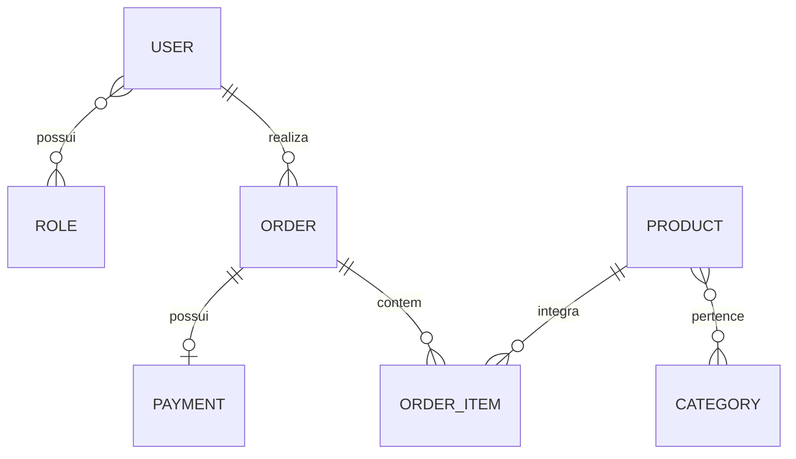

<div align="center">

# DSCommerce

### API REST de e-commerce com Java e Spring Boot

Backend desenvolvido para praticar **modelagem de domínio, arquitetura em camadas, persistência de dados e segurança de APIs REST**.


</div>

## Sobre o projeto

O **DSCommerce** é uma API backend que representa parte do fluxo de um comércio eletrônico: consulta ao catálogo, manutenção de produtos e registro de pedidos por usuários autenticados.

Foi desenvolvido como projeto de estudos da trilha **Java Spring Professional**, da **DevSuperior**, ministrada por **Nélio Alves**. A implementação utiliza o domínio proposto no curso para consolidar conceitos de desenvolvimento backend com Spring.

### Funcionalidades implementadas

- **Catálogo de produtos:** listagem paginada, busca por nome e consulta detalhada por ID.
- **Gerenciamento de produtos:** cadastro, atualização e exclusão, com acesso reservado ao perfil administrador.
- **Categorias:** consulta das categorias cadastradas.
- **Pedidos:** criação de pedidos com itens e consulta por ID.
- **Autenticação:** emissão de tokens JWT por meio de um fluxo OAuth2 customizado para o projeto de estudos.
- **Controle de acesso:** restrições por perfil e verificação de que o pedido pertence ao usuário autenticado, salvo quando ele possui permissão administrativa.
- **Validações e erros:** validação dos dados de entrada e tratamento centralizado de exceções.

## Destaques técnicos

| Conceito | Aplicação no código |
| --- | --- |
| **Arquitetura em camadas** | Separação de responsabilidades entre `Controller`, `Service` e `Repository`, utilizando DTOs na comunicação da API. |
| **Persistência e modelagem JPA** | Relacionamentos entre entidades, inclusive muitos-para-muitos e uma classe de associação com chave composta (`OrderItem`). |
| **Consultas ao banco** | JPQL para busca de produtos por nome e SQL nativo com projeção para consultar usuários e seus perfis. |
| **Transações** | Uso de `@Transactional` nas operações de serviço e configuração `open-in-view=false`. |
| **Segurança** | Spring Security, BCrypt, JWT e autorização declarativa com `@PreAuthorize`, além de verificação de propriedade dos pedidos na camada de serviço. |

### Decisões de negócio que merecem destaque

**Preservação do preço da compra.** Na criação de um pedido, o preço do produto é copiado para o `OrderItem`. Dessa forma, uma alteração posterior no catálogo não modifica o valor registrado naquele pedido.

**Associação do pedido ao usuário autenticado.** Ao registrar uma compra, o backend identifica o comprador pelo contexto de autenticação em vez de confiar em um identificador enviado na requisição.

**Verificação de acesso ao pedido.** Na busca por ID, o serviço permite a consulta pelo proprietário ou por um usuário com `ROLE_ADMIN`.

## Modelo de domínio

O domínio contempla usuários e perfis de acesso, produtos e categorias, pedidos, itens de pedido e pagamentos.



A relação entre `Order` e `Product` é representada por `OrderItem`, que armazena **quantidade** e **preço unitário** e utiliza uma chave composta por pedido e produto.

## Tecnologias utilizadas

- **Java 17** e **Spring Boot 3.4.4**
- **Spring Web** e **Spring Data JPA / Hibernate**
- **Spring Security**, **OAuth2 Authorization Server** e **JWT**
- **Jakarta Bean Validation**
- **H2 Database** (perfil local `test`)
- **Maven**

## Endpoints implementados

As rotas abaixo correspondem aos controllers e à configuração de autenticação presentes no código.

| Método | Endpoint | Descrição | Restrição definida no projeto |
| --- | --- | --- | --- |
| `POST` | `/oauth2/token` | Autenticar e obter JWT | Credenciais válidas |
| `GET` | `/products` | Listar e filtrar produtos (paginação) | Público |
| `GET` | `/products/{id}` | Consultar produto | Público |
| `POST` | `/products` | Cadastrar produto | `ROLE_ADMIN` |
| `PUT` | `/products/{id}` | Atualizar produto | `ROLE_ADMIN` |
| `DELETE` | `/products/{id}` | Excluir produto | `ROLE_ADMIN` |
| `GET` | `/categories` | Listar categorias | Público |
| `GET` | `/users/me` | Consultar usuário autenticado | `ROLE_CLIENT` ou `ROLE_ADMIN` |
| `POST` | `/orders` | Criar pedido | `ROLE_CLIENT` |
| `GET` | `/orders/{id}` | Consultar pedido | Proprietário ou `ROLE_ADMIN` |

### Exemplos de requisições

Consulta pública ao catálogo, com filtro por nome:

```http
GET http://localhost:8080/products?name=pc&page=0&size=12&sort=name,asc
```

Exemplo de corpo enviado para criar um pedido **com um JWT válido**:

```http
POST http://localhost:8080/orders
Authorization: Bearer SEU_TOKEN_JWT
Content-Type: application/json
```

```json
{
  "items": [
    { "productId": 1, "quantity": 2 },
    { "productId": 3, "quantity": 1 }
  ]
}
```

## Como executar

**Pré-requisitos:** JDK 17 ou superior e conexão com a internet para obter as dependências. O repositório no GitHub contém o **Maven Wrapper**.

```bash
# Clonar o repositório
git clone https://github.com/VictorTbrandi/dscommerce.git
cd dscommerce

# Iniciar a aplicação no Linux/macOS
./mvnw spring-boot:run
```

No **Windows (PowerShell)**, execute `.\mvnw.cmd spring-boot:run`. Se já tiver o Maven instalado, também pode usar `mvn spring-boot:run`.

Com a aplicação iniciada, consulte o catálogo em:

```text
http://localhost:8080/products
```

O projeto utiliza o perfil `test`, com banco **H2 em memória** e dados iniciais definidos em `src/main/resources/import.sql`. O console H2 está configurado em `http://localhost:8080/h2-console`, com URL JDBC `jdbc:h2:mem:testdb`, usuário `sa` e senha em branco.

### Autenticação para testes locais

O endpoint `POST /oauth2/token` recebe o cliente OAuth2 por **Basic Auth** e as credenciais de usuário em `application/x-www-form-urlencoded`, com os campos `grant_type=password`, `username` e `password`.

As configurações locais do cliente usam, por padrão, `CLIENT_ID=myclientid` e `CLIENT_SECRET=myclientsecret`. Também há variáveis para a duração do JWT (`JWT_DURATION`) e as origens CORS (`CORS_ORIGINS`). Esses valores padrão são destinados a estudos.

> **Nota:** o grant OAuth2 `password` é um fluxo legado, implementado aqui para fins didáticos; não é uma escolha recomendada para novos sistemas em produção.

## Origem e escopo

Este projeto reúne conteúdos trabalhados nos módulos de **injeção de dependência**, **modelo de domínio e ORM**, **API REST e CRUD**, **JPA e consultas** e **login e controle de acesso** da trilha Java Spring Professional.

A API implementa **parte dos casos de uso** previstos para o DSCommerce. O documento original propõe também outras operações e fluxos de interface que não fazem parte dos endpoints deste repositório. A etapa de homologação, implantação e CI/CD não está incluída.

[Protótipos de referência do DSCommerce (Figma)](https://www.figma.com/file/ZrGNVNG0kZL6txDv4G8P6s/DSCommerce)

---

<div align="center">

Desenvolvido por **[Victor Terrengui Brandi](https://github.com/VictorTbrandi)** · [LinkedIn](https://www.linkedin.com/in/victor-brandi/)

</div>
